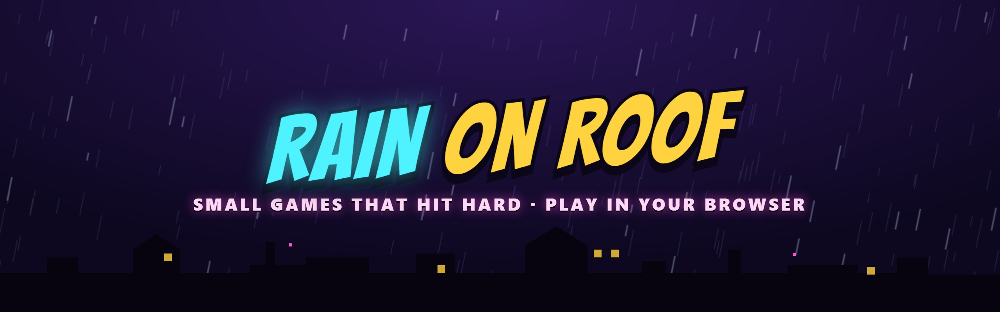
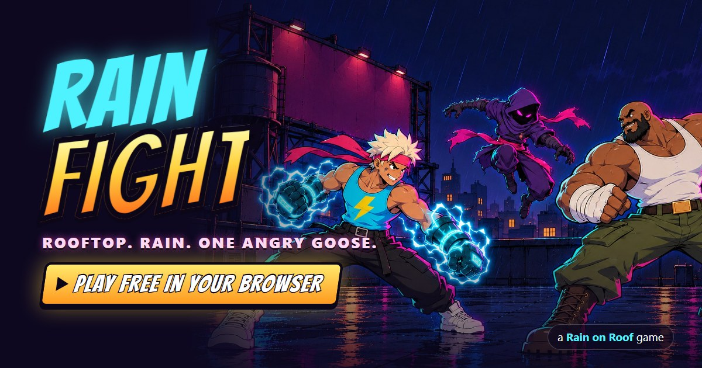
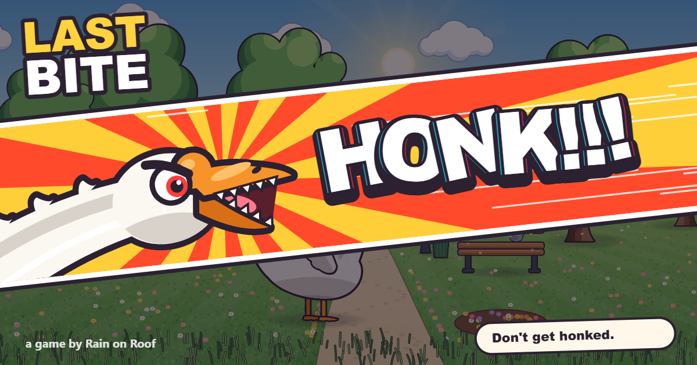

**Small games that hit hard.** No download, no install, no account: open the link and play, on a phone or a desktop.

## Games

<table>
<tr>
<td width="50%" valign="top">

<h3><a href="https://github.com/rain-on-roof/rain-fight">Rain Fight</a></h3>
A cartoon fighting game on a rooftop in the rain. Four fighters, one of them a goose, ridiculous finishers, a phonk soundtrack. Solo against the CPU or two players on one screen.
  

</td>
<td width="50%" valign="top">

<h3><a href="https://github.com/rain-on-roof/last-bite">Last Bite</a></h3>
Eat your sandwich on a park bench. Let go when the goose stares. One button, one goose, and a HONK you will hear in your sleep.
  

</td>
</tr>
</table>

Every game here is open source: plain HTML, JavaScript and Canvas, no engine and no build step. Read the code, fork it, send a pull request.
